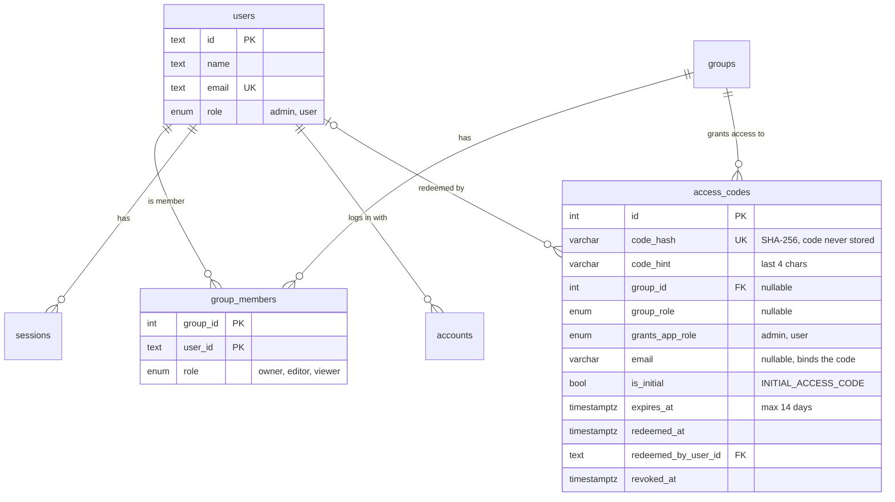
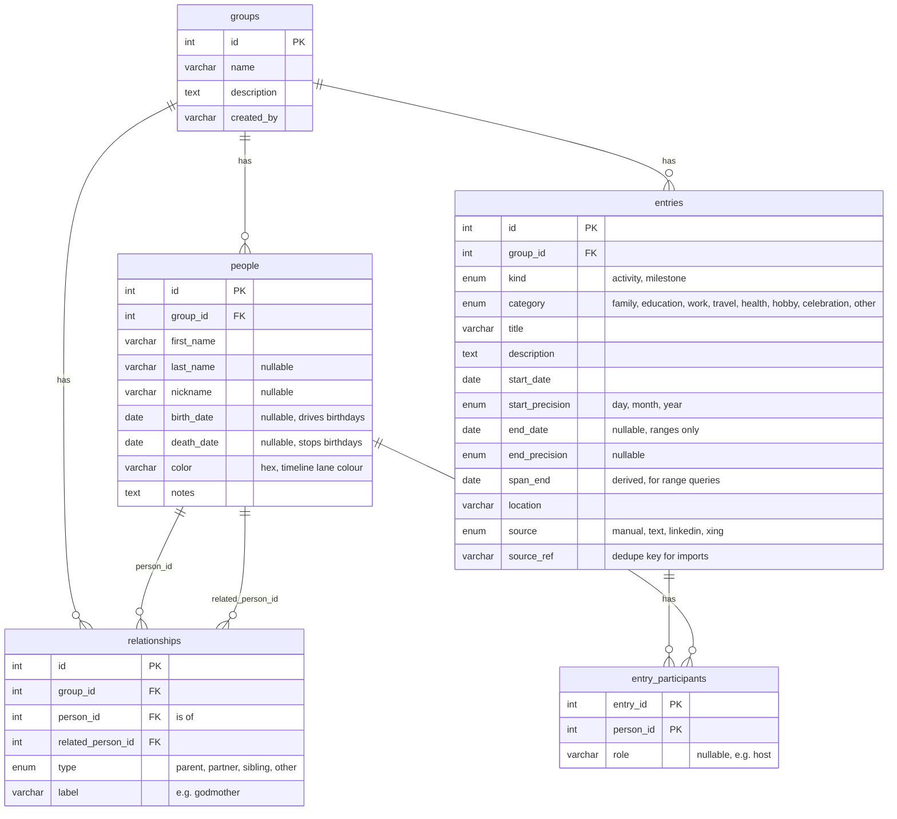

# Data model (draft v2)

Everything lives inside a **group** (a family or circle of people). Each group has its own
people, relationships and timeline entries. Birthdays are not stored; they are generated
from `people.birth_date` when the timeline is requested.

Two separate concepts: **users** are login accounts (who may use the app), **people** are who
appears on the timeline. A grandparent can be a person without ever being a user.

## Access

- `users`, `sessions`, `accounts` and `verifications` belong to Better Auth. `accounts` holds
  the Google account id, so one user could later have several login methods. `users.role`
  is our addition; Better Auth never lets clients set it.
- `group_members` decides what a user sees. App admins see every group as owner.
- `access_codes`: an account can only be created by redeeming a code (see README). Redeeming
  is a single conditional `UPDATE`, so a code can never be used twice, even concurrently.
  Never-downgrade rule: redeeming a viewer code does not lower an existing editor membership.

## Timeline content

All tables except `entry_participants` and `relationships` also have `created_by`,
`created_at` and `updated_at`.

## Tables

### groups
A family or circle sharing one timeline. All API routes below `/groups/:groupId` are scoped
to one group, and every repository query filters by `group_id`. This is the natural place to
attach access control once users exist.

### people
People shown on the timeline (left panel in the sketch). They are **not** login accounts:
grandparents or children can be on the timeline without ever signing in.

| Column | Notes |
| --- | --- |
| `first_name` | Required. `last_name` and `nickname` are optional. |
| `birth_date` | Full date only. Birthdays (age 0 = birth) are generated from it. |
| `death_date` | Optional. No birthdays are generated after it. Must be on or after birth. |
| `color` | Hex colour for the person's lane or avatar in the UI. |

### relationships
Directed edge: `person_id` **is `type` of** `related_person_id`.

- `parent`: directional. "Anna is parent of Ben". Viewing Ben, Anna shows up as `parent`;
  viewing Anna, Ben shows up as `child`. A reverse parent link is rejected.
- `partner`, `sibling`: symmetric, stored once with the lower id first, so duplicates are impossible.
- `other`: free `label` (godmother, best friend, ...).

Grandparents, aunts and cousins are derivable from parent and sibling links and are not
stored separately.

### entries
Anything on the timeline: activities (a trip, a dinner) and milestones (graduation, wedding,
moving house).

**Partial dates.** Life events are often only known to the month or year, especially imported
CV data. The API accepts `"2019"`, `"2019-06"` or `"2019-06-14"` and stores a full date plus
its precision:

| Input | Stored as start | Stored as end |
| --- | --- | --- |
| `2019` | `2019-01-01`, year | `2019-12-31`, year |
| `2019-06` | `2019-06-01`, month | `2019-06-30`, month |
| `2019-06-14` | `2019-06-14`, day | `2019-06-14`, day |

Responses return `{ value, date, precision }`, so the UI can show "June 2019" and send
`value` straight back when editing.

- `end_date` is only set for periods (an apprenticeship, a holiday week).
- `span_end` is derived: `end_date` if present, otherwise the last day of the start period.
  It is never sent by clients and not returned. It makes "everything overlapping this window"
  a plain `start_date <= to AND span_end >= from` query, which any SQL database can index.
- `source` and `source_ref` record where an imported entry came from. A unique index on
  `(group_id, source, source_ref)` makes re-importing the same content a no-op.

### entry_participants
Many-to-many between entries and people, with an optional `role`. An entry without
participants is a family-wide entry.

## Database integrity rules
- Death date on or after birth date; entry end on or after start; `end_precision` set exactly when `end_date` is set.
- No self-relationships; one relationship per (person, related person, type).
- Deleting a group deletes everything in it, including memberships and its access codes.
- Deleting a user deletes their sessions, logins and memberships; content they created stays.
- An access code grants a group (with a role) and/or the admin role, never nothing.
- Deleting a person removes their relationships
  and participations, the entries themselves stay.

## Deliberately left out of v1 (open questions)
1. **Linking users to people.** Optional `people.user_id` ("this person is me") for
   "my timeline" or letting people edit their own entries. `created_by` already stores the user id.
2. **Attachments** (photos, documents on entries). Would be an `attachments` table with a
   storage key; the files themselves belong in object storage, not the database.
3. **Times of day.** Entries are date based. If you want "dinner at 19:00", add an optional
   `start_time` or switch to timestamps for day-precision entries.
4. **Recurring events** other than birthdays (anniversaries, yearly holidays).
5. **Memorial items** on the timeline for `death_date` (currently only stops birthdays).
6. **Ids.** Integer identity like in iot-dementia-platform. Switch to UUIDs if ids should
   not be guessable or entries get created offline.
